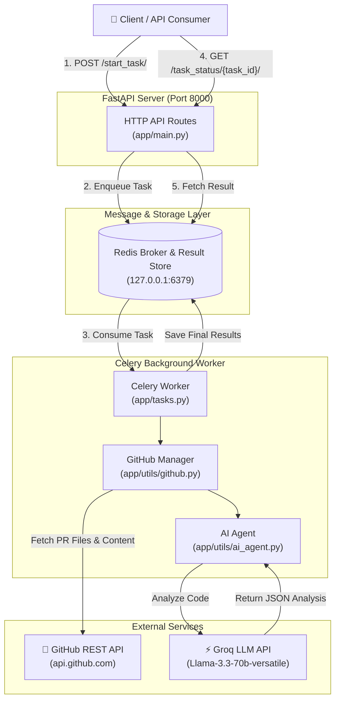
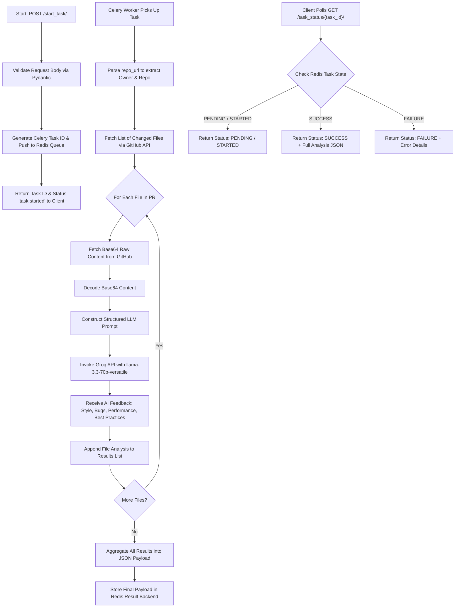

# 🔍 PRLens — AI-Powered Pull Request Analysis Service

**PRLens** is a high-performance, asynchronous RESTful API service built with **FastAPI**, **Celery**, **Redis**, and **Groq (Llama-3.3-70B)**. It automatically fetches pull request changes from GitHub, extracts file contents, and leverages advanced AI to perform deep code reviews for bugs, performance bottlenecks, style issues, and security/best-practice violations.

---

## 📋 Table of Contents

- [Features](#-features)
- [Architecture & System Flow](#-architecture--system-flow)
  - [High-Level Architecture Diagram](#high-level-architecture-diagram)
  - [PR Analysis Execution Flowchart](#pr-analysis-execution-flowchart)
- [Project Directory Structure](#-project-directory-structure)
- [Tech Stack](#-tech-stack)
- [Prerequisites](#-prerequisites)
- [Installation & Setup](#-installation--setup)
  - [1. Clone the Repository](#1-clone-the-repository)
  - [2. Create a Virtual Environment](#2-create-a-virtual-environment)
  - [3. Install Dependencies](#3-install-dependencies)
  - [4. Configure Environment Variables](#4-configure-environment-variables)
- [Running the Application](#-running-the-application)
  - [Step 1: Start Redis Server](#step-1-start-redis-server)
  - [Step 2: Start Celery Worker](#step-2-start-celery-worker)
  - [Step 3: Start FastAPI Application](#step-3-start-fastapi-application)
- [API Reference & Usage](#-api-reference--usage)
  - [1. Start PR Analysis Task](#1-start-pr-analysis-task)
  - [2. Poll Task Status & Results](#2-poll-task-status--results)
- [Sample LLM Output Schema](#-sample-llm-output-schema)
- [Troubleshooting](#-troubleshooting)

---

## ✨ Features

- **⚡ Asynchronous Task Processing**: Uses Celery and Redis to handle long-running PR analysis without blocking HTTP requests.
- **🤖 Powered by Groq & Llama-3.3-70B**: Delivers lightning-fast, high-accuracy code analysis and structured suggestions.
- **🐙 GitHub Integration**: Dynamically extracts changed files and file content directly via the GitHub REST API.
- **🔒 Optional Private Repo Support**: Supports GitHub Personal Access Tokens for private repository analysis.
- **📊 Real-time Status Polling**: Query task execution status (`PENDING`, `STARTED`, `SUCCESS`, `FAILURE`) at any time.

---

## 🏗️ Architecture & System Flow

### High-Level Architecture Diagram

The diagram below illustrates how client applications interact with the FastAPI web server, Redis message broker, Celery worker nodes, GitHub API, and Groq LLM API:



---

### PR Analysis Execution Flowchart

Here is the step-by-step lifecycle of an analysis task from initiation to completion:



---

## 📁 Project Directory Structure

```
PRLens/
├── app/
│   ├── __init__.py
│   ├── main.py          # FastAPI application routes & endpoints
│   ├── celery_app.py    # Celery app initialization & Redis configuration
│   ├── tasks.py         # Celery task definitions (analyse_repo_task)
│   └── utils/
│       ├── __init__.py
│       ├── ai_agent.py   # Groq LLM integration & prompt engineering
│       └── github.py     # GitHub API fetching & PR processing logic
├── .env                 # Environment secrets (GROQ_API_KEY)
├── .gitignore           # Git ignore patterns
├── requirements.txt     # Python dependencies
└── README.md            # Project documentation
```

---

## 🛠️ Tech Stack

- **Framework**: [FastAPI](https://fastapi.tiangolo.com/) (Python 3.9+)
- **Asynchronous Task Queue**: [Celery](https://docs.celeryq.dev/)
- **Message Broker & Result Store**: [Redis](https://redis.io/)
- **AI / LLM Engine**: [Groq Cloud API](https://groq.com/) using `llama-3.3-70b-versatile`
- **Data Validation**: [Pydantic](https://docs.pydantic.dev/)
- **HTTP Client**: `requests`
- **Environment Management**: `python-dotenv`

---

## 📋 Prerequisites

Before running the application, make sure you have the following installed:

1. **Python 3.9** or higher
2. **Redis Server** (Installed locally or running via Docker)
3. **Groq API Key** (Obtain a free API key from [Groq Console](https://console.groq.com/))
4. **GitHub Personal Access Token** *(Optional, required for private repositories or higher rate limits)*

---

## ⚙️ Installation & Setup

### 1. Clone the Repository

```bash
git clone https://github.com/your-username/PRLens.git
cd PRLens
```

### 2. Create a Virtual Environment

**On Linux/macOS:**
```bash
python3 -m venv venv
source venv/bin/activate
```

**On Windows (PowerShell):**
```powershell
python -m venv venv
.\venv\Scripts\Activate.ps1
```

### 3. Install Dependencies

```bash
pip install -r requirements.txt
```

### 4. Configure Environment Variables

Create a `.env` file in the root directory (or edit the existing `.env`):

```env
GROQ_API_KEY=your_groq_api_key_here
```

---

## 🚀 Running the Application

Running the service requires three running processes: **Redis**, **Celery Worker**, and **FastAPI Server**.

### Step 1: Start Redis Server

Ensure Redis is running locally on port `6379`.

**Using Docker:**
```bash
docker run -d --name redis-server -p 6379:6379 redis
```

**Or using local Redis CLI:**
```bash
redis-server
```

---

### Step 2: Start Celery Worker

Open a new terminal window, activate your virtual environment, and launch the Celery worker:

**On Linux/macOS:**
```bash
celery -A app.celery_app.app worker --loglevel=info
```

**On Windows:**
```powershell
celery -A app.celery_app.app worker --loglevel=info --pool=solo
```

---

### Step 3: Start FastAPI Application

Open another terminal window, activate your virtual environment, and run Uvicorn:

```bash
uvicorn app.main:app --reload --port 8000
```

Once running, interactive API docs will be available at:
- **Swagger UI**: [http://127.0.0.1:8000/docs](http://127.0.0.1:8000/docs)
- **ReDoc**: [http://127.0.0.1:8000/redoc](http://127.0.0.1:8000/redoc)

---

## 📖 API Reference & Usage

### 1. Start PR Analysis Task

Triggers an asynchronous code analysis job for a specified GitHub Pull Request.

- **Endpoint**: `POST /start_task/`
- **Headers**: `Content-Type: application/json`

#### Request Body Schema

| Parameter | Type | Required | Description |
|---|---|---|---|
| `repo_url` | `string` | **Yes** | Full GitHub repository URL (e.g. `https://github.com/fastapi/fastapi`) |
| `pr_number` | `integer` | **Yes** | The Pull Request number to analyze |
| `github_token` | `string` | *Optional* | GitHub PAT for private repos or higher API rate limits |

#### Example Request (`curl`)

```bash
curl -X POST "http://127.0.0.1:8000/start_task/" \
     -H "Content-Type: application/json" \
     -d '{
           "repo_url": "https://github.com/octocat/Hello-World",
           "pr_number": 1,
           "github_token": "ghp_yourPersonalAccessTokenHere"
         }'
```

#### Example Response (200 OK)

```json
{
  "task_id": "b3e64f89-21c4-4a25-9b2f-1a83e091b4cd",
  "status": "task started"
}
```

---

### 2. Poll Task Status & Results

Checks the status of an ongoing task and retrieves the complete review when finished.

- **Endpoint**: `GET /task_status/{task_id}/`

#### Path Parameters

| Parameter | Type | Description |
|---|---|---|
| `task_id` | `string` | The UUID returned by `POST /start_task/` |

#### Example Request (`curl`)

```bash
curl -X GET "http://127.0.0.1:8000/task_status/b3e64f89-21c4-4a25-9b2f-1a83e091b4cd/"
```

#### Example Response - In Progress (`PENDING` / `STARTED`)

```json
{
  "task_id": "b3e64f89-21c4-4a25-9b2f-1a83e091b4cd",
  "status": "PENDING"
}
```

#### Example Response - Completed (`SUCCESS`)

```json
{
  "task_id": "b3e64f89-21c4-4a25-9b2f-1a83e091b4cd",
  "status": "SUCCESS",
  "result": {
    "task_id": "b3e64f89-21c4-4a25-9b2f-1a83e091b4cd",
    "results": [
      {
        "filename": "app/main.py",
        "results": "{\n  \"issues\": [\n    {\n      \"type\": \"best_practice\",\n      \"line\": 18,\n      \"description\": \"github_token is optional, consider fetching default token from environment variables.\",\n      \"suggestion\": \"github_token: Optional[str] = os.getenv('GITHUB_TOKEN')\"\n    }\n  ]\n}"
      }
    ]
  }
}
```

---

## 📝 Sample LLM Output Schema

The AI agent analyzes each file and formats issues into structured JSON containing four main error categories: `style`, `bug`, `performance`, and `best_practice`.

```json
{
  "issues": [
    {
      "type": "bug",
      "line": 42,
      "description": "Potential UnboundLocalError if response status code is not 200.",
      "suggestion": "Add proper status checking and exception handling before accessing response data."
    },
    {
      "type": "performance",
      "line": 85,
      "description": "Synchronous HTTP call inside an async endpoint blocks the event loop.",
      "suggestion": "Use httpx or a background worker thread to process HTTP calls asynchronously."
    }
  ]
}
```

---

## 🔧 Troubleshooting

| Issue | Cause | Solution |
|---|---|---|
| `Connection refused: Redis` | Redis server is not running on `127.0.0.1:6379` | Start Redis via `docker run -p 6379:6379 redis` or `redis-server`. |
| `ValueError: GROQ_API_KEY not found` | `.env` file missing or API key invalid | Ensure `.env` contains a valid `GROQ_API_KEY`. |
| `HTTPError: 403 Client Error (Rate Limit)` | GitHub API unauthenticated rate limit reached (60 req/hr) | Pass a `github_token` in your API request body. |
| Celery task stuck on Windows | Default prefork pool issues on Windows OS | Run Celery with `--pool=solo` flag on Windows. |

---

<p align="center">Made with ❤️ using FastAPI, Celery, Redis & Groq AI</p>
